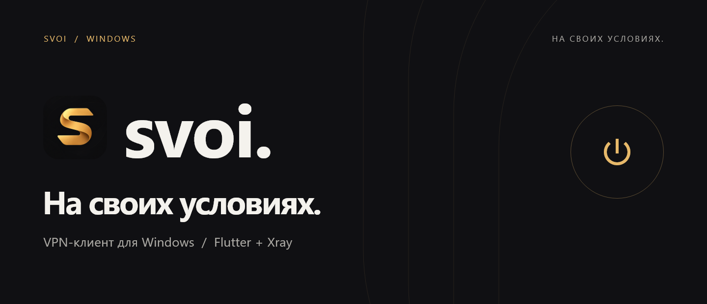
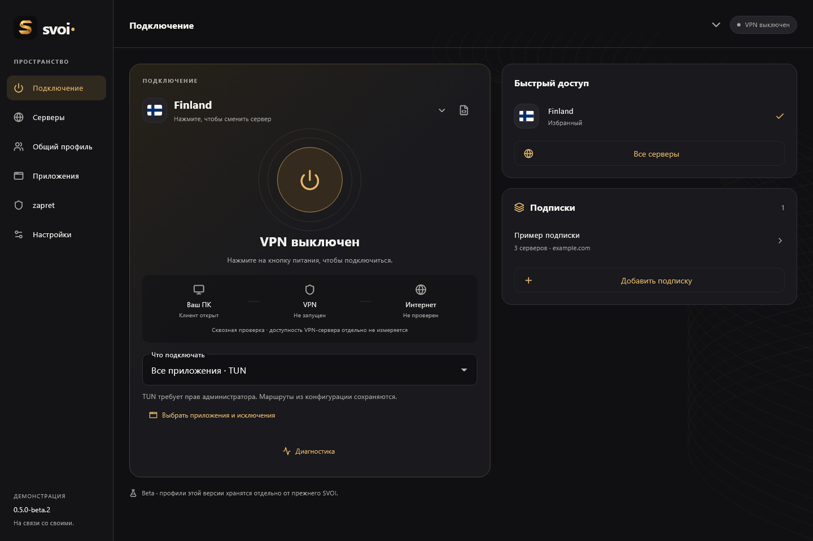
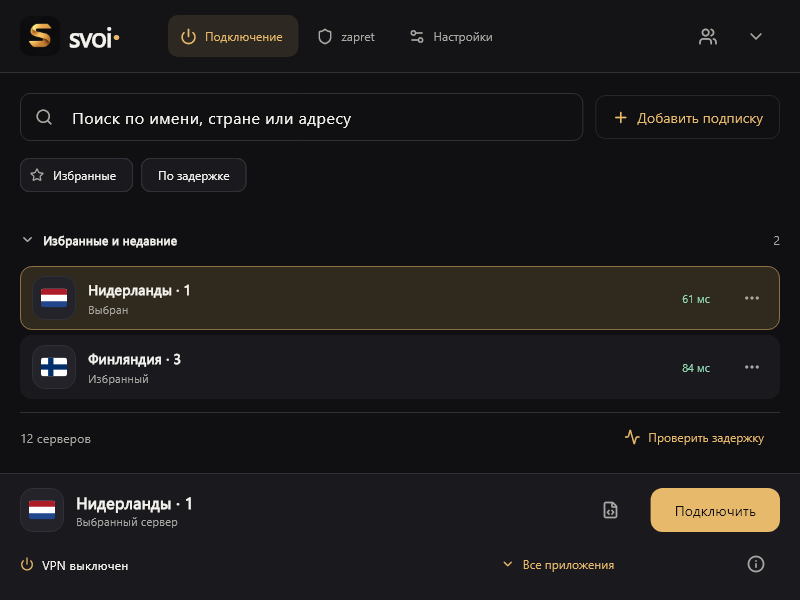
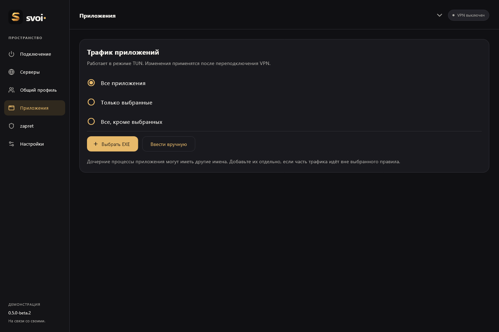
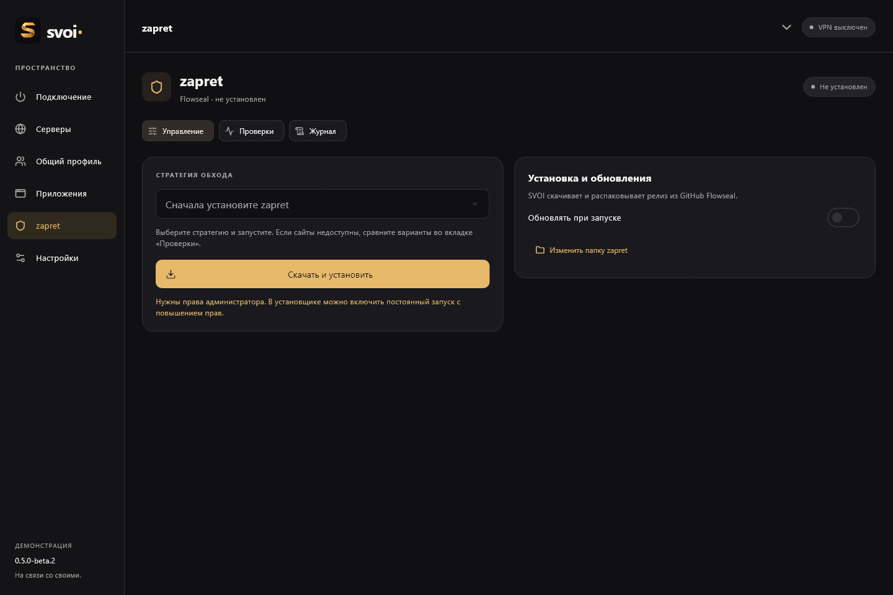
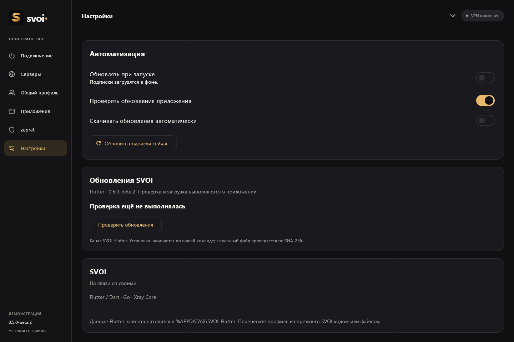
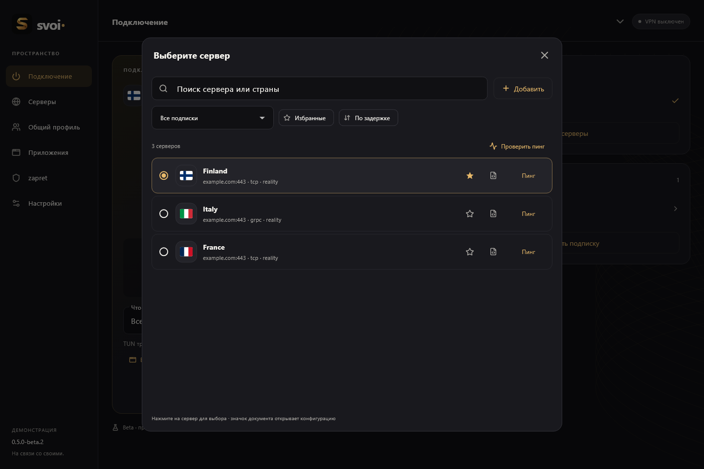

<p align="center">
  
</p>

<p align="center">
  <a href="https://github.com/1atex/svoi/releases/latest"></a>
  
  <a href="LICENSE"></a>
  
  
</p>

<p align="center">
  <b>Ваши подписки. Ваши маршруты. Одно приложение.</b><br>
  Клиент на Flutter / Dart с движком Go / Xray и открытым исходным кодом.
</p>

<p align="center">
  <a href="https://github.com/1atex/svoi/releases/download/v0.5.0-beta.6/SVOI-0.5.0-beta.6-windows-x64-setup.exe"><b>↓ Скачать для Windows</b></a>
  &nbsp; · &nbsp;
  <a href="https://github.com/1atex/svoi/releases/latest">Последний релиз</a>
  &nbsp; · &nbsp;
  <a href="https://github.com/1atex/svoi/issues">Сообщить об ошибке</a>
</p>

---

## Подключение без лишних экранов

Выберите сервер и нажмите на кнопку включения. Режим подключения, подписки и быстрый доступ к избранному находятся рядом.



<sub>Настоящие компоненты интерфейса 0.5.0-beta.2 с демонстрационными данными. Адреса заменены на example.com; подключения и замеры на этих кадрах не выполнялись.</sub>

## Всё необходимое — внутри

| Подключения | Управление |
| :--- | :--- |
| **Несколько подписок** — импорт по ссылке, из текста или файла. Обновление при запуске. | **Серверы под рукой** — страны, поиск, избранное, сортировка по задержке. |
| **Три режима** — TUN, системный прокси и локальный прокси для ручной настройки. | **Проверка связи** — параллельные HTTPS-проверки с лимитом 4 секунды на сервер. |
| **Маршруты из конфигурации** — полные Xray JSON-профили с правилами и балансировщиками. | **Просмотр JSON** — исходная конфигурация и конфигурация, подготовленная для подключения. |
| **Трафик выбранных приложений** — включения и исключения для TUN. | **Перенос профиля** — кодом или файлом, с предпросмотром перед импортом. |
| **zapret в интерфейсе** — загрузка и обновление релизов Flowseal, стратегии и проверки. | **Обновления SVOI** — проверка, скачивание, SHA-256 и запуск установки из приложения. |

**Протоколы:** VLESS · VMess · Trojan · Shadowsocks. Также поддерживается импорт полных профилей Xray; доступность конкретного транспорта зависит от конфигурации и версии ядра.

<table>
  <tr>
    <td width="50%"><br><b>Нужный сервер — в пару действий</b></td>
    <td width="50%"><br><b>Решайте, какой трафик подключать</b></td>
  </tr>
</table>

<details>
<summary><b>Ещё скриншоты: zapret, обновления и выбор сервера</b></summary>

### zapret



### Автоматизация и обновления



### Быстрое переключение



</details>

## Первый запуск

1. **Установите SVOI.** [Установщик Windows x64](https://github.com/1atex/svoi/releases/download/v0.5.0-beta.6/SVOI-0.5.0-beta.6-windows-x64-setup.exe) уже содержит Xray, Wintun и необходимые библиотеки. WebView2 не нужен.
2. **Добавьте свою подписку.** Вставьте ссылку или импортируйте конфигурацию из файла / текста.
3. **Выберите сервер и режим.** Для TUN нужны права администратора. Нажмите на кнопку включения.

Предпочитаете без установки? [Скачайте portable ZIP](https://github.com/1atex/svoi/releases/download/v0.5.0-beta.6/SVOI-0.5.0-beta.6-windows-x64.zip), распакуйте **весь архив** и запустите `svoi.exe`.

Установщик предлагает запуск после установки. Ярлык на рабочем столе и запуск от имени администратора включены по умолчанию; флажки можно снять. При запуске с повышенными правами Windows покажет запрос UAC.

## Автозапуск Windows

В **Настройки → Автоматизация** включите запуск SVOI при входе в Windows и, при необходимости, последней выбранной стратегии zapret. Приложение запустится в трее; VPN подключается вручную. Настройка требует прав администратора и создаёт задачу только для текущего пользователя. Для zapret предварительно выберите стратегию на его странице.

## Обновляйтесь из приложения

В **Настройках** можно включить проверку релизов и автоматическое скачивание. Когда обновление готово, запустите установку из SVOI — заходить на GitHub каждый раз не требуется. Перед установкой приложение останавливает соединения и закрывается.

<details>
<summary><b>Перенос с прежнего WebView-клиента</b></summary>

В beta.4 рабочие данные находятся в `%APPDATA%/SVOI`. Данные beta.3 и более ранних версий из `SVOI-Flutter` переносятся автоматически; исходная папка сохраняется. Если в `SVOI` уже были данные прежнего WebView-клиента, они сохраняются отдельно в `SVOI-backup-…`. Папки данных и коды переноса содержат доступ к подпискам — не публикуйте их.

</details>

## Статус проекта

**0.5.0-beta.6 · Windows x64.** Android и iOS пока не выпускаются. SVOI использует ваши подписки; VPN-серверы в комплект не входят.

- Проверка одного HTTPS-адреса не гарантирует доступность всех сайтов. «Нет ответа» не блокирует подключение.
- Совместимость TUN и zapret зависит от стратегии и сети. Kill switch пока отсутствует.
- Перенос профиля не отменяет серверные ограничения провайдера.

Нашли проблему? [Создайте issue](https://github.com/1atex/svoi/issues), укажите версию, режим подключения и шаги воспроизведения. Удалите из журналов ключи, ссылки на подписки и коды переноса.

---

<details>
<summary><b>Разработчикам: сборка, архитектура и выпуск релизов</b></summary>

## Разработка

- [Flutter: сборка, тесты и архитектура](flutter_client/README.md)
- [Примечания к релизу](flutter_client/RELEASE-NOTES.md)
- [Структура исходников](docs/DEVELOPMENT.md)
- [Измерения производительности](docs/PERFORMANCE.md)

Нужны Go, Flutter 3.47.7, Visual Studio с C++ Desktop workload и Inno Setup 6:

```powershell
./prepare-core.ps1
./flutter_client/build-prototype.ps1 -FlutterSdk C:/path/to/flutter
```

Скрипт проверяет исходники и собирает приложение, ZIP, установщик и SHA-256 в `releases/v<версия>/`. SDK, пользовательские данные и сборки исключены из Git.

## Выпуск обновления

1. Обновите `nativeVersion` в `main.go`, версию в `flutter_client/pubspec.yaml`, `clientVersion` в `flutter_client/lib/features.dart`, версию сборочного скрипта и release notes.
2. Выполните проверки и соберите пакет локально.
3. Отправьте коммит и тег `v<версия>` в GitHub.

Workflow `.github/workflows/release.yml` проверит версии, скачает закреплённые SDK и Xray с проверкой SHA-256, выполнит тесты и опубликует установщик, ZIP и контрольные суммы. Beta и стабильные версии публикуются обычным Release с отметкой Latest; prebeta и rc — как prerelease. Дождитесь успешного workflow перед объявлением релиза. Клиенты принимают установщик своего канала и проверяют его digest из GitHub API.

Иконки экспортируются из исходной аватарки: `python assets/brand/export-icons.py` (Pillow).

</details>

## Лицензия

SVOI распространяется под [MIT](LICENSE). Лицензии Xray, Wintun, Flutter и зависимостей включены в дистрибутив.

<p align="center"><b>На связи со своими.</b></p>
